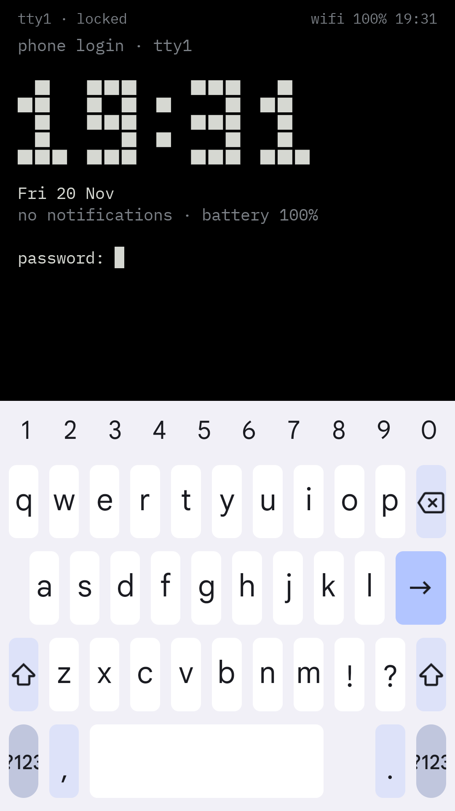

# Terminal Launcher

An Android launcher that is one terminal: it is the lock screen and the home screen.
You log in with a password, then type commands to use the phone.

<p>
  
  
</p>

## Install

**With Obtainium:** add an app with the source URL `https://github.com/MarvynBailly/terminal-launcher`.
While this repository is private, Obtainium needs a GitHub token that can read it
(Obtainium settings, then "GitHub personal access token").

**By hand:** download the APK from [Releases](../../releases) and open it on the phone.

Then open "Terminal Launcher", run `setup`, and tap `home` to make it the default launcher.
`setup` also lists the other access Android has you grant by hand.

## Commands

| Command | What it does |
| --- | --- |
| `ls [-l] [text]` | list apps, optionally filtered |
| `open <app>` | launch an app; typing the app's name alone also works |
| `info <app>` | open the app's system page (uninstall, force stop) |
| `notifs [clear]` | show or clear notifications |
| `call <name>` | call a contact |
| `sms <name> <msg>` | open your messages app with the text filled in |
| `torch [on\|off]` | flashlight |
| `wifi`, `bt` | open Android's Wi-Fi and Bluetooth panels |
| `vol [0-100]`, `bright [0-100]` | media volume and screen brightness |
| `battery`, `date` | status |
| `theme [name]` | `default`, `green`, `amber` or `eink` |
| `alias [name=cmd]` | define shortcuts (`ll` is `ls -l`) |
| `history` | recent commands |
| `passwd [-d]` | set, change or remove the password |
| `setup [name]` | list or grant the access the launcher needs |
| `lock`, `clear`, `help` | lock the terminal, clear the screen, list commands |

The chips above the keyboard complete what you are typing, and `↑` recalls earlier commands.
App names in `ls` output can be tapped.

## The lock

There is no password until you run `passwd`. After that the terminal locks on `lock`, when the
screen turns off, and when the phone restarts. Three wrong passwords start a timed lockout.

This is a launcher-level lock, not a security boundary: Android does not let an app replace its
own lock screen, and the notification shade and recent apps stay reachable while the terminal is
locked. Keep Android's screen lock on if the phone needs protecting. If you forget the password,
clear the app's data in Android settings.

## Build

Requires JDK 17 and the Android SDK (platform 34).

```bash
./gradlew assembleDebug        # app/build/outputs/apk/debug/app-debug.apk
./gradlew testDebugUnitTest    # shell tests, no device needed
```

The command interpreter in `app/src/main/java/com/terminallauncher/shell/` is plain Kotlin and
talks to the phone through the `Phone` interface, which `AndroidPhone.kt` implements. The UI is
Jetpack Compose (`ui/TerminalScreen.kt`). `demo/index.html` is the original browser mock-up.

## Release

Push a version tag. The workflow in `.github/workflows/release.yml` runs the tests, builds a
signed APK and publishes it as a GitHub release, which Obtainium then offers as an update.

```bash
git tag v0.2.0
git push origin v0.2.0
```

The version name comes from the tag and the version code is derived from it (`0.2.0` is 200).

Releases are signed with `keystore/release.jks`, using the credentials in `keystore.properties`.
Both are git-ignored and mirrored as the repository secrets `KEYSTORE_BASE64`,
`KEYSTORE_PASSWORD`, `KEY_ALIAS` and `KEY_PASSWORD`. Android refuses updates signed with a
different key, so keep a backup of both files. With them in place, `./gradlew assembleRelease`
produces the same signed build locally.

## Credits

The typeface is IBM Plex Mono, under the SIL Open Font License (`licenses/IBM-Plex-Mono-OFL.txt`).
