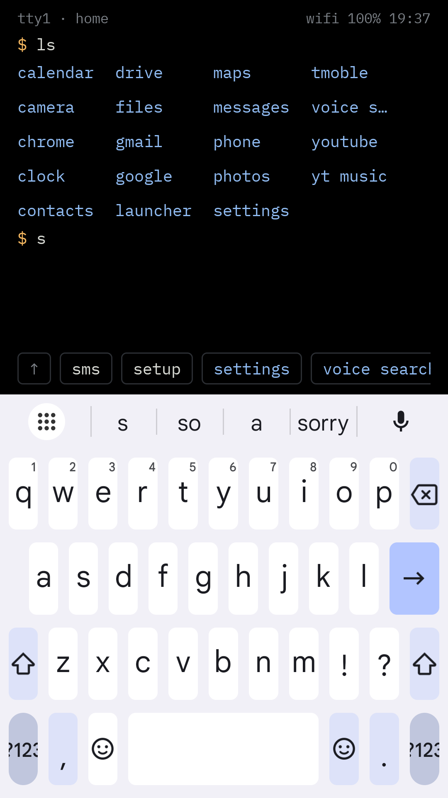

# Terminal Launcher

An Android launcher that is one terminal: it is the lock screen and the home screen.
You log in with a password, then type commands to use the phone.

<p>
  
  
</p>

## Install

**With Obtainium:** add an app with the source URL `https://github.com/MarvynBailly/terminal-launcher`.

**By hand:** download the APK from [Releases](../../releases) and open it on the phone.

Then open "Terminal Launcher", run `setup`, and tap `home` to make it the default launcher.
`setup` also lists the other access Android has you grant by hand.

## Commands

| Command | What it does |
| --- | --- |
| `ls [-l] [text]` | list apps, optionally filtered |
| `open <app>` | launch an app; typing the app's name alone also works |
| `info <app>` | open the app's system page (uninstall, force stop) |
| `notifs [clear]` | show or clear notifications |
| `call <name>` | call a contact |
| `sms <name> <msg>` | open your messages app with the text filled in |
| `torch [on\|off]` | flashlight |
| `wifi`, `bt` | open Android's Wi-Fi and Bluetooth panels |
| `vol [0-100]`, `bright [0-100]` | media volume and screen brightness |
| `np [pause\|play\|next\|prev]` | what is playing, with progress and controls |
| `battery`, `date` | status |
| `screen` | how long the phone was in use, and how often it was unlocked, each day of the last week |
| `screen budget [time\|off]` | set a daily budget of screen time, such as `2h` or `90m`, or remove it |
| `cal [month] [year]` | a month calendar with today marked |
| `weather [city]` | the weather now and for five days, for your city or for another one just this once |
| `weather set <city>`, `weather units [c\|f]` | choose the city `weather` reports, and Celsius or Fahrenheit |
| `weather login [on\|off]` | show the weather in the login summary, or leave it out |
| `fetch` | a system card: Android version, device, uptime, apps, battery, storage |
| `theme [name]` | `default`, `green`, `amber`, `eink`, `nord`, `gruvbox`, `dracula`, `solarized`, `synthwave` or `paper` |
| `saver [name]` | the lock screen's screensaver: `rain`, `stars`, `life`, `clock`, `shuffle` or `off`; `saver show` previews it |
| `fx [on\|off]` | turn the animations on or off |
| `ssh [user@]host [-p port]` | log in to another computer; `ssh` alone lists the ones you have used |
| `ssh key`, `ssh-copy-id <host>` | show this phone's SSH key, or add it to a computer so it stops asking for a password |
| `ssh forget <host>` | forget a computer's saved fingerprint |
| `alias [name=cmd]` | define shortcuts (`ll` is `ls -l`) |
| `history` | recent commands |
| `passwd [-d]` | set, change or remove the password |
| `setup [name]` | list or grant the access the launcher needs |
| `lock`, `clear`, `help` | lock the terminal, clear the screen, list commands |

The chips above the keyboard complete what you are typing, and `↑` recalls earlier commands.
App names in `ls` output can be tapped. A mistyped command offers the nearest match; tapping it
puts it at the prompt.

## Motion

The terminal behaves like an old machine:

- **Waking** opens the screen from a bright line and prints a short boot log above the password
  prompt. `lock` collapses the screen to a dot.
- **A right password** resolves "access granted" out of noise while the clock breaks apart, then
  the login summary prints: how far through the day, week and year you are, the weather in your
  city, how long you have been on the phone today, what is waiting, and a tip.
- **Output** prints line by line, `ls` fills in as a wave, and opening an app grows its line until
  it fills the screen.
- **Notifications** that arrive while the terminal is open type themselves above the prompt, and
  the status line shows the track that is playing. Both need `setup notifs`.
- **Screensavers** start on the lock screen after 30 seconds without a touch, only while the phone
  is charging. They keep the screen on for up to 10 minutes, then let it sleep. Any touch ends one.

None of it blocks typing: what you type while something is still printing is kept. `fx off` turns
all of it off, and so does Android's own "remove animations" setting. `saver off` turns the
screensaver off.

## SSH

`ssh alex@desktop` logs in to another computer and hands it the prompt. Each line you type runs
there and what it prints appears in the terminal, until `exit` or the `disconnect` chip brings the
launcher's `$` back. With Tailscale or WireGuard running on the phone, a computer on that network
is reached by the name or address it has there.

This is a line terminal, not a full one:

- **Works:** anything that prints lines, such as `ls`, `cd`, `git`, `tail`, `systemctl` or
  `docker ps`, and anything that asks a question. A password prompt, such as the one `sudo` shows,
  is typed unseen.
- **Does not work:** programs that draw the whole screen, such as `vim`, `htop`, `top` and `tmux`.
  A pager like `less` still pages: `q` and Enter leaves it.
- **Chips:** `^C` stops the running command, `^D` ends input, `disconnect` hangs up, and `↑`
  recalls what you typed in this session.

**Logging in.** The phone makes its own key the first time one is needed. `ssh key` shows the
public half, and `ssh-copy-id user@host` logs in once with the password and adds the key there,
after which no password is asked. Without the key, the password is asked for at a hidden prompt.

**Knowing the computer.** The first connection shows the computer's key fingerprint and asks whether
to trust it. From then on the fingerprint is checked without a word, and a computer that shows a
different one is refused with a warning. `ssh forget <host>` drops a saved fingerprint, for a
computer that was reinstalled.

**Windows computers** are not asked for a terminal, because the one they give redraws the screen
instead of printing lines. Commands work the same, but there is no `^C`: `disconnect` is how to
stop one. `ssh-copy-id` leaves them alone too, so the key has to be added there by hand.

**What protects it.** The private key stays on the phone, encrypted with a key that Android's
keystore holds and will not give out. If a launcher password is set, `ssh` asks for it again unless
it was typed in the last five minutes. A session ends when the screen turns off. `ssh` and
`weather` are the only parts of the launcher that use the network.

A computer set up to offer only an Ed25519 host key needs a phone whose Android can check one.
Android 14 cannot, and `ssh` then says the two have no method in common. Computers set up the
usual way offer other kinds as well.

## Weather

`weather` prints the weather now and for the next five days in your city. `weather set <city>`
chooses that city, and the first city you ever ask about is remembered as well. `weather tokyo`
shows another city once and leaves yours alone.

- **Towns that share a name:** `weather set springfield, illinois` picks one by its region or
  country. After a `set` the others are listed, and tapping one switches to it.
- **Units:** `weather units c` or `weather units f`. Until one is chosen they follow the phone's
  region.
- **An app called weather:** `open weather` still opens it.
- **At login:** once a city is set, the login summary has one line of it: the weather now, today's
  high and low, and the chance of rain or snow when that is 30% or more. Tapping the line runs
  `weather`. It never holds the prompt up: the line reads `weather …` until the answer is in.
  `weather login off` leaves it out.

Forecasts come from [Open-Meteo](https://open-meteo.com), which needs no account. Two things are
sent: the city's name, to find it, and the city's position, to get its forecast. The name is sent
only when you run `weather` with a city. The position is sent when you run `weather`, and when the
login summary prints, unless the forecast it has is recent: ten minutes for the command, half an
hour for the summary. So with a city set, unlocking the phone can ask Open-Meteo for a forecast,
at most twice an hour; `weather login off` stops that. The phone's own location is never read.

## Screen time

`screen` shows, for each of the last seven days, how long the phone was in use and how many times
it was unlocked, with the average of the whole days. The login summary has today's two numbers,
so they are in front of you every time you unlock.

- **Turning it on:** `setup usage` opens Android's "usage access" switch for the launcher. Until
  that is on, `screen` says how to turn it on and the summary has no such line.
- **What counts:** the phone is in use while its screen is on and Android's lock screen is down.
  A look at the lock screen, or at the terminal's password page on top of it, counts for nothing.
  An unlock is each time the phone goes from that to being in use.
- **A daily budget:** `screen budget 2h` sets how much screen time is meant to be enough for a
  day. The login summary then has a fourth bar, `phone`, under the day's, week's and year's. It
  fills as the day's time is used and turns red once the budget is spent. `screen` measures each
  day's bar against the budget, marks the days that went over, and says how much of today is
  left. It is a reminder: nothing is blocked. `screen budget off` removes it.
- **With Android's lock set to None** there is no lock screen to go by. Every time the screen
  turns on is then an unlock, and time on the terminal's password page counts as use.
- **Where the numbers come from:** Android's own usage log, the one its Digital Wellbeing page is
  drawn from. Android writes it whether or not the launcher is running, so nothing is missed while
  another app is open or after the launcher restarts. It is read on the phone and sent nowhere.
- **Its limits:** `screen` shows as many of the seven days as Android still holds. A phone that
  dies without shutting down loses the last minutes of its log, up to about twenty. Where the log
  has such a hole the launcher counts less, not more. Android 8 keeps no such log.

## The lock

There is no password until you run `passwd`. After that the terminal locks on `lock`, when the
screen turns off, and when the phone restarts. Three wrong passwords start a timed lockout.

While it is locked, the terminal shows on top of Android's own lock screen, so its password page
is the first thing on screen when the phone wakes. Android's lock is still underneath:

- **Android lock set to PIN, pattern or fingerprint:** after the right terminal password, Android
  asks for its own unlock, and only then does the terminal open. Use the fingerprint sensor when
  Android asks, not before.
- **Android lock set to Swipe or None:** the terminal password alone opens the phone.

After a restart Android's lock comes first, because no app can run until the phone has been
unlocked once.

The terminal password is not a security boundary by itself. Android does not let an app replace
its lock screen, and the notification shade stays reachable while the terminal is locked. Keep
Android's screen lock on if the phone needs protecting. If you forget the terminal password,
clear the app's data in Android settings.

## Build

Requires JDK 17 and the Android SDK (platform 34).

```bash
./gradlew assembleDebug        # app/build/outputs/apk/debug/app-debug.apk
./gradlew testDebugUnitTest    # shell tests, no device needed
```

The command interpreter in `app/src/main/java/com/terminallauncher/shell/` is plain Kotlin and
talks to the phone through the `Phone` interface, which `AndroidPhone.kt` implements. The UI is
Jetpack Compose: `ui/TerminalScreen.kt` is the screen, `ui/Rows.kt` draws each kind of output line,
`ui/Effects.kt` holds the timing of the animations and `ui/Savers.kt` the screensavers.
SSH follows the same split: `shell/Remote.kt` is what the shell asks for and how a remote shell's
output becomes lines, and `AndroidSsh.kt` provides it with the JSch library. So does the weather:
`shell/Weather.kt` is what the shell asks for, and `OpenMeteo.kt` fetches and reads it.
`shell/ScreenTime.kt` adds Android's log of the screen and the lock up into days of use.
`demo/index.html` is the original browser mock-up.

## Release

Push a version tag. The workflow in `.github/workflows/release.yml` runs the tests, builds a
signed APK and publishes it as a GitHub release, which Obtainium then offers as an update.

```bash
git tag v0.2.0
git push origin v0.2.0
```

The version name comes from the tag and the version code is derived from it (`0.2.0` is 200).

Releases are signed with `keystore/release.jks`, using the credentials in `keystore.properties`.
Both are git-ignored and mirrored as the repository secrets `KEYSTORE_BASE64`,
`KEYSTORE_PASSWORD`, `KEY_ALIAS` and `KEY_PASSWORD`. Android refuses updates signed with a
different key, so keep a backup of both files. With them in place, `./gradlew assembleRelease`
produces the same signed build locally.

## Credits

The typeface is IBM Plex Mono, under the SIL Open Font License (`licenses/IBM-Plex-Mono-OFL.txt`).
SSH connections are made with [JSch](https://github.com/mwiede/jsch), under BSD-style licenses
(`licenses/JSch-LICENSE.txt`).
Weather data is by [Open-Meteo](https://open-meteo.com), under
[CC BY 4.0](https://creativecommons.org/licenses/by/4.0/).
